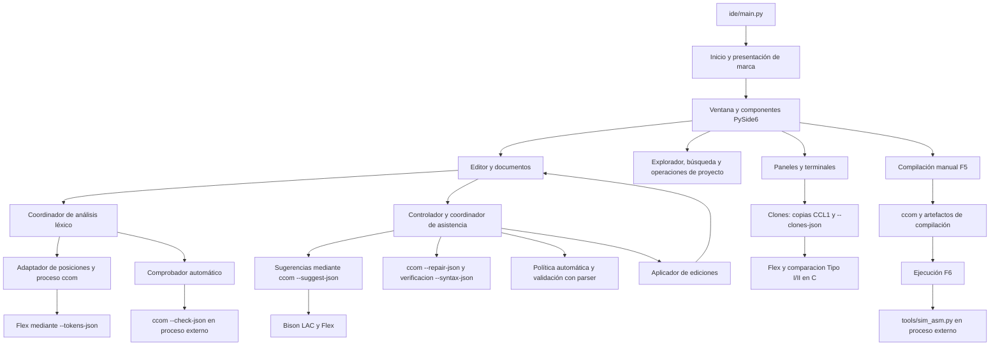

# CALSIDE: guía unificada del sistema

Estado vigente · 2026-11-11. M1–M7 implementados localmente; las decisiones del lenguaje reutilizan C y la interfaz/gestión del IDE usan Python. La validación registrada incluye 400 pruebas IDE y suite del compilador. Revisión humana, empaquetado y otra máquina conservan su propio cierre: [plan](plan_ide.md), [revisión manual](revision_manual.md). El [historial](bitacora_ide.md) conserva entregas anteriores.

Este documento sirve para entender el IDE antes de modificarlo y como recorrido para revisar y comentar sus archivos. La lista de revisión del final todavía no significa que todos los archivos hayan recibido nuevos comentarios.

## Índice

1. [Qué es CALSIDE y qué está disponible](#1-qué-es-calside-y-qué-está-disponible)
2. [Arquitectura y conexiones](#2-arquitectura-y-conexiones)
3. [Conceptos y estado que conviene conocer](#3-conceptos-y-estado-que-conviene-conocer)
4. [Arranque, documentos y cierre](#4-arranque-documentos-y-cierre)
5. [Qué sucede al escribir](#5-qué-sucede-al-escribir)
6. [Compilar y ejecutar](#6-compilar-y-ejecutar)
7. [Núcleo LL(1)](#7-núcleo-ll1)
8. [Sugerencias, reparaciones y política automática](#8-sugerencias-reparaciones-y-política-automática)
9. [Archivos, carpetas y protección del disco](#9-archivos-carpetas-y-protección-del-disco)
10. [Búsqueda, clones, terminales y preferencias](#10-búsqueda-clones-terminales-y-preferencias)
11. [Concurrencia, cancelación y límites](#11-concurrencia-cancelación-y-límites)
12. [Inventario de archivos de producción](#12-inventario-de-archivos-de-producción)
13. [Pruebas: dónde comprobar cada parte](#13-pruebas-dónde-comprobar-cada-parte)
14. [Recorrido para comentar archivo por archivo](#14-recorrido-para-comentar-archivo-por-archivo)
15. [Pendientes y mantenimiento de esta guía](#15-pendientes-y-mantenimiento-de-esta-guía)

## 1. Qué es CALSIDE y qué está disponible

CALSIDE es una aplicación de escritorio para editar programas Calser, recibir diagnósticos, compilar con `ccom` y ejecutar mediante el simulador del repositorio. La interfaz utiliza **Python y PySide6/Qt**. Abrirla no exige VS Code; en desarrollo se inicia con Python o `make ide`. El empaquetado para distribuirla como ejecutable sigue pendiente.

La distribución visual incluye cabecera, menús, explorador/búsqueda, pestañas de código, panel de resultados y barra de estado. El panel puede estar abajo o a la derecha. La esquina morada todavía es estática; la presentación de inicio de 4,4 s está implementada, se omite con clic/Esc y se desactiva desde Ver.

Conviene distinguir estas responsabilidades:

| Parte | Qué hace hoy | Implementación |
| --- | --- | --- |
| Interfaz | Ventanas, editor, marcas, explorador, paneles, atajos y diálogos. | Python/PySide6 en `ide/interfaz/`. |
| Lógica del IDE | Lectura/guardado, búsqueda, transporte de clones, conversiones de posiciones y política de asistencia. | Python en `ide/`. |
| Núcleo del IDE | Modelos de asistencia productivos; lexer/gramática/tabla/parser LL(1) de consulta y pruebas, fuera del backend gráfico. | Python sin Qt en `ide/nucleo/`. |
| Compilador | Análisis completo del lenguaje, semántica y generación de artefactos. | Ejecutable `ccom`; fuentes C en `src/` y gramática Flex/Bison en `grammar/`. |
| Simulador | Ejecuta el listado generado y produce registros, memoria y traza. | Proceso Python externo: `tools/sim_asm.py`. |
| Shell | Ejecuta comandos escritos por el usuario en una terminal independiente. | Shell del sistema mediante un auxiliar PTY en Linux. |

Por tanto, el IDE incluye lógica propia en Python además de widgets. `ccom` sigue siendo la herramienta de compilación; el parser Python no sustituye su semántica ni su generación de código.

**Disponible:** edición con pestañas, explorador jerárquico y operaciones de archivos/carpetas, búsqueda, lexer en vivo, comprobación automática con ccom, compilación F5, ejecución F6, clones Tipo I/II, terminales y preferencias. Contrato, coordinador, aplicador, interfaces manuales y política de asistencia están conectados a proveedores C reales.

**Sugerencias reales M3:** motor C conectado al menú/Ctrl+Espacio y pausa opcional. **Reparaciones reales M4:** cierres validados por C, panel y regla opcional de punto y coma. La aplicación no utiliza proveedores ficticios. El catálogo automático incluye una regla revisada, desactivada hasta que el usuario la habilite; los ejemplos controlados viven en pruebas.

## 2. Arquitectura y conexiones



Las flechas representan llamadas o flujo de datos, no importaciones exactas. Sugerencias M3 y reparaciones M4 consultan el backend C real. Clones M5 también consulta Flex/comparación en C mediante `--clones-json`.

### La ventana central y los componentes que reutiliza

`Ventana`, en `ide/interfaz/ventana.py`, construye los widgets y conecta señales con acciones. Su clase hereda de:

```python
class Ventana(ReparacionesVentana, EjecucionVentana,
              AccionesArchivos, ProyectoVentana, QMainWindow):
    ...
```

`ReparacionesVentana`, `EjecucionVentana`, `AccionesArchivos` y `ProyectoVentana` son **mixins**: agrupan métodos que operan sobre la misma instancia de ventana. No son cuatro ventanas ni cuatro procesos. `AccionesArchivos` hereda, además, de `SeleccionArchivos` para los lotes.

Esto permite repartir comportamiento entre archivos, pero los mixins comparten atributos y servicios de `Ventana`. Al comentar sus métodos hay que explicar esos requisitos: por ejemplo, `EjecucionVentana` usa el editor activo, la carpeta del repositorio, la salida de ejecución y el comprobador automático creados en otro lugar.

Los coordinadores son objetos separados: `CoordinadorAnalisis`, `ComprobadorCcom`, `AsistenciaEditor`, `MonitorDisco` y los trabajadores de búsqueda/clones. La ventana conserva sus instancias y conecta sus resultados.

### Cómo se comunican

Qt usa **señales y slots**. Una señal anuncia un evento; el método conectado lo recibe. Por ejemplo:

```text
Editor.analisisSolicitado(documento, revision, texto)
    → CoordinadorAnalisis.solicitar(...)
    → trabajador léxico
    → CoordinadorAnalisis.resultado(ResultadoLexico)
    → Ventana.recibir_analisis(...)
    → Editor.aplicar_analisis(...)
```

En los trabajos asíncronos viajan copias del texto y datos del contexto. Los trabajadores no reciben permiso para modificar widgets; la aplicación de resultados ocurre en el hilo gráfico.

## 3. Conceptos y estado que conviene conocer

### Documento, archivo y proyecto

- **Documento:** pestaña de código con texto en memoria. Existe incluso antes de guardarla.
- **Archivo:** ruta del disco asociada a un documento. `editor.path` es `None` en un documento sin nombre.
- **Proyecto:** carpeta abierta en el explorador, almacenada en `Ventana.project`. Actualmente es una carpeta de trabajo, no un manifiesto que defina un sistema de compilación de varios archivos.
- **Raíz del repositorio:** `Ventana.root`. Se utiliza para encontrar herramientas y recursos. Puede ser diferente de la carpeta del proyecto.
- **Buffer:** texto actual del editor. Puede ser distinto del archivo guardado.

### Identidad y revisión

Cada `Editor` tiene `documento_id`, generado independientemente de su ruta, y `revision`, que aumenta cuando cambia el texto. Renombrar una ruta no crea otra identidad de documento. El indicador `document().isModified()` sirve para saber si hay cambios sin guardar; no reemplaza la revisión.

Una tarea captura una **instantánea**: el texto y la identidad/revisión que está analizando. Si llega una respuesta después de que el usuario siguió escribiendo, se descarta. En asistencia se exige, además, que sigan coincidiendo cursor y selección.

### Tres unidades de posición

| Origen | Unidad relevante | Dónde se adapta |
| --- | --- | --- |
| Python, lexer del núcleo y contratos de ediciones | Índices de caracteres Python; rangos `[inicio, fin)`. | `ide/ediciones.py` y adaptadores. |
| Diagnósticos de ccom | Columnas expresadas en bytes UTF-8. | `Editor.rango_problema`, respetando `Problema.unidad`. |
| Qt y `QTextCursor` | Unidades UTF-16. | `ide/interfaz/editor.py`, `ide/interfaz/ediciones.py` y `adaptador_nucleo.py`. |

En un rango `[inicio, fin)`, `inicio` está incluido y `fin` queda fuera. Una inserción tiene `inicio == fin`. Línea/columna presentadas al usuario suelen comenzar en 1; los offsets comienzan en 0. Los comentarios deben indicar la unidad: una tilde o un emoji hace que estas cantidades puedan ser diferentes.

### Estado principal de la ventana

| Atributo | Propósito |
| --- | --- |
| `tabs` | Documentos abiertos; cada widget es un `Editor`. |
| `panels` | Pestañas de Problemas, Salida de ccom, Clones, Análisis de ccom, Ejecución, Reparaciones y terminales. |
| `results` | Diagnósticos de compilaciones manuales asociados a cada editor. |
| `auto_results` | Diagnósticos de comprobaciones automáticas asociados a cada editor. |
| `process` / `compilation` | Proceso de compilación manual y contexto del documento que lo originó. |
| `compilados` | Compilaciones correctas registradas durante esta sesión para permitir F6. |
| `run_process` / `run_info` | Proceso y artefactos de la ejecución actual. |
| `operacion_carpetas` | Operación de carpeta activa; permite bloquear rutas que se están trasladando. |
| `asistencia` | Controlador que une el editor, preferencias, propuestas y coordinador de motores. |

`Editor` también conserva diagnósticos léxicos, estado de análisis, versión del disco y selección/cursor. No todo el estado del documento está en la ventana.

## 4. Arranque, documentos y cierre

### Arranque

1. `ide/main.py:main` crea `QApplication`, establece nombre, estilo e icono y calcula la raíz a partir de la ubicación del propio archivo.
2. Crea `Inicio`, que lee `animacion_inicio` en las preferencias existentes (activada por defecto), muestra `Presentacion` si corresponde y programa la inicialización. `app.exec()` entrega el control al bucle Qt.
3. `Inicio` construye `Ventana(root)` en el hilo gráfico. Su constructor prepara interfaz, acciones y servicios; `iniciar_proyecto` carga preferencias y crea el monitor del disco.
4. Se crea `AsistenciaEditor`, se conecta el panel de reparaciones, se abre una pestaña nueva y se restauran preferencias/proyecto.
5. En turnos posteriores de eventos, si hay argumentos, selecciona la carpeta del primero y abre una ruta por turno.
6. Una barrera espera **ventana preparada** y **presentación terminada u omitida**. Entonces muestra la ventana antes de retirar la presentación. Sin animación, se muestra en cuanto está preparada.

`ide/interfaz/inicio.py` usa `QVariantAnimation`, `QPainterPath` y
`QSvgRenderer`: 1200 ms de trazado de los seis fragmentos, 900 ms de
desplazamiento, 2000 ms de letras y 300 ms finales de giro. El hexágono
gira a velocidad constante durante los 4400 ms completos (unos 43°/s),
empezando a unos −189° y terminando a 0° sin recolocación brusca. La composición
aprobada vive en `assets/branding/calside-inicio.svg`: hexágono regular de
seis fragmentos iguales, segundo fragmento morado contando desde arriba en
sentido horario, CALS naranja e IDE morado. La D es el reflejo exacto de C.
La variante CALSER se conserva en `assets/branding/calser-marca-geometrica.svg`.

`MarcaInicio` carga el SVG una sola vez. Las máscaras vectoriales recorren los
trazos centrales y revelan sus contornos exactos. Cada fragmento se limita a
su propia región para evitar adelantar el siguiente al atravesar una división.
La escena lógica de 1600×900 se escala con Qt, sin bitmaps ni fuentes instaladas.
Al terminar se dibuja directamente el SVG aprobado; las comprobaciones 1×/2×
verifican que el giro continúe durante las letras y al final, conserve los
colores y llegue al SVG estático sin un salto de orientación. Los logos PNG
anteriores se conservan para sus usos existentes, fuera de esta presentación.

Clic/Esc y cerrar la presentación omiten solo su tiempo visual restante. Si la
carga sigue pendiente se conserva la composición con «Preparando el editor…».
**Ver → Animación al iniciar CALSIDE** persiste inmediatamente el booleano
`animacion_inicio` en `estado_v1`, con validación y sin perder los otros campos.

No hay `sleep`, bucles de espera ni llamadas reentrantes a `processEvents` en
producción. Los pasos de arranque se programan con `QTimer`; esto no crea un
hilo ni vuelve paralela la construcción de widgets o la lectura inicial de
archivos, que conservan su recorrido existente en el hilo Qt. Los servicios de
análisis, explorador y disco mantienen sus mecanismos asíncronos. La animación
no espera a completar un análisis de ccom para entregar el editor. Si falla la
inicialización, se retira la presentación, se informa el error y se sale con 1.

El orden importa: por ejemplo, las acciones y widgets deben existir antes de que la configuración de asistencia intente habilitarlos o conectar sus señales.

### Abrir o crear un documento

`Ventana.nuevo` crea el `Editor`, registra su asistencia y conecta sus señales de edición, cursor y análisis. `Ventana.abrir` evita duplicar una ruta abierta, utiliza `archivos.cargar` y asocia texto y estado del disco al editor.

El texto cargado se interpreta como UTF-8, admite BOM inicial y normaliza finales de línea a LF. La pestaña muestra nombre, cambios sin guardar y aviso de conflicto externo cuando corresponde.

Guardar utiliza `Ventana.guardar` y `archivos.guardar`. Antes de cerrar un documento modificado se elige guardar, descartar o cancelar. Al cerrar se retiran solicitudes y resultados asociados para no aplicarlos a otra pestaña.

### Cierre de la aplicación

`Ventana.closeEvent` comprueba compilación/ejecución y operaciones de carpetas activas, resuelve documentos modificados y pregunta por terminales activas. Después detiene asistencia, búsqueda, monitor, clones, análisis léxico y comprobador; cierra terminales y guarda preferencias.

Si un trabajador no termina en el plazo de espera, se aplaza el cierre. Destruir un `QThread` activo o forzar su terminación puede dejar estado inconsistente; ese es el motivo de los métodos `detener`, los callbacks y los mensajes de espera.

## 5. Qué sucede al escribir

Hay dos recorridos de diagnóstico y un recorrido opcional de asistencia. No hay que confundir sus temporizadores.

### Léxico en vivo

```text
Cambio real del texto
    → Editor.cambio: aumenta revision y limpia marcas antiguas
    → contenidoCambiado: Ventana.edicion invalida resultados anteriores
    → pausa de 300 ms
    → Editor.analisisSolicitado
    → CoordinadorAnalisis / TareaLexica
    → adaptador_nucleo.analizar_documento
    → ccom --tokens-json sobre copia temporal UTF-8
    → Flex publica tokens/comentarios y diagnósticos JSON
    → convertir_lexico adapta bytes a UTF-16
    → ResultadoLexico
    → Editor.aplicar_analisis, solo si documento/revision siguen vigentes
```

Flex produce tokens, comentarios y errores. El adaptador valida el JSON y convierte sus rangos de bytes UTF-8 a tramos UTF-16 y diagnósticos compatibles con el editor; no reconoce lexemas ni busca comentarios. La tarea de fondo llama a un proceso ccom cancelable, con temporal privado, límite de 5 s y respuesta acotada. Sin ccom compatible se informa el fallo sin respaldo Python. Detalles en [M2](../../docs/ccom_servicios_ide.md#tokens).

`Resaltado`, un `QSyntaxHighlighter`, aplica los formatos. `Margen` dibuja números de línea y puntos de error. El resaltado no debe aumentar la revisión, ensuciar el documento ni añadir acciones de Deshacer; `Editor.cambio` distingue cambios reales de señales debidas al formato.

### Comprobación automática con ccom

Después de recibir el léxico de esa revisión, `Ventana.programar_comprobacion` comprueba que esté habilitada, haya contenido y no existan errores léxicos. Entonces programa otra pausa de **600 ms** en `ComprobadorCcom`.

El comprobador escribe una copia temporal del buffer, ejecuta `ccom --check-json copia.cls`, valida los diagnósticos estructurados de stdout y conserva los logs de stderr. Reasocia las rutas de la copia al documento original. No guarda el documento del usuario ni genera sus artefactos de compilación. También permite analizar documentos sin nombre.

Las pausas se reinician con las ediciones; los 300 + 600 ms describen el recorrido previsto, no un plazo de respuesta garantizado: influyen el tiempo del lexer y las tareas en cola.

### Presentación de problemas

`Problema`, en `ide/diagnosticos.py`, es el modelo común: archivo/documento, origen, categoría, mensaje, rango y unidad de columna. `ccom.diagnosticos_json` valida el protocolo del análisis automático; `ccom.diagnosticos` mantiene la lectura textual para F5. El adaptador léxico construye diagnósticos del núcleo. El léxico vivo utiliza `ccom.lexico_json` y origen ccom léxico. La categoría JSON ya viene decidida por C; Python no la deduce del mensaje.

`Ventana.actualizar_problemas` combina los resultados válidos de las pestañas. Evita duplicados exactos entre ccom manual y automático y da prioridad a ccom sobre un error léxico equivalente del núcleo. No elimina indiscriminadamente todos los diagnósticos de otro origen.

`Editor.rango_problema` convierte la ubicación en una selección Qt. La tabla permite navegar; el margen y subrayado indican el lugar; la franja inferior muestra el detalle. Un error general como «falta main» se cuenta y muestra sin inventar línea o subrayado.

La asistencia no publica actualmente otra fuente de diagnósticos del parser en Problemas. Esa integración y su prioridad se decidirán al recibir los motores.

### Documentos sin código y datos de archivos

El resultado léxico incluye `contiene_codigo`, calculado a partir de las categorías que ya produjo Flex, sin volver a reconocer comentarios en Python. Si no hay tokens de código ni errores léxicos, la interfaz cancela/retira solo la comprobación sintáctica automática y muestra «Sin código para analizar». Esto permite comentarios válidos sin exigir un programa mientras se edita. Un bloque de comentario sin cerrar conserva su error. F5 también consulta el resultado vigente de Flex: si solo hay comentarios válidos, muestra «El archivo solo contiene comentarios; no hay código para compilar» en Salida, sin crear un problema sintáctico ni generar artefactos. Para un archivo vacío muestra un aviso equivalente. Si el léxico aún está pendiente espera de forma asíncrona; una edición posterior cancela esa solicitud de compilación. Los programas con código mantienen su compilación normal.

El editor rechaza `text/uri-list` al insertar/arrastrar/pegar archivos: la representación `file://...` no se añade al código. El texto plano y las rutas copiadas explícitamente como texto se pegan normalmente, con Deshacer. Guardar persiste el buffer; no añade el nombre de destino al contenido.

### Recuperación de varios errores

Bison puede continuar tras errores independientes usando separadores/cierres. La UI muestra la lista real; completar una expresión puede eliminar su diagnóstico y conservar otro. `parser_syntax_errors()` impide semántica, exportación de AST y generación si hubo errores, incluso con `yyparse()==0`. Los árboles parciales solo se conservan para limpieza.

Máximo 32 errores y 4096 tokens descartados sin ancla; un límite se informa como truncado. Un separador faltante puede hacer que se omita parte del código. Sugerencias/reparaciones mantienen primer error; esta recuperación no amplía la API del LL(1) Python. [Diseño y límites](../../docs/ccom_servicios_ide.md#recovery).

## 6. Compilar y ejecutar

### F5: operación manual seleccionada

`Ventana.compilar` realiza este recorrido:

1. Rechaza superponer compilación/ejecución y operar sobre rutas ocupadas.
2. Localiza `ccom`: ruta configurada, ejecutable de la raíz del repositorio y finalmente PATH.
3. Solicita guardar si el documento no tiene nombre o está modificado; comprueba cambios externos.
4. Captura editor, revisión, ruta y versión del disco.
5. Valida el perfil de `ide/compilacion.py` y las salidas protegidas. Por defecto crea una salida por ruta de fuente: `<carpeta del fuente>/build/ide/<hash de ruta de 10 caracteres>/`.
6. Suspende el comprobador automático y lanza un `QProcess`, aproximadamente:

   ```sh
   ccom programa.cls -o build/ide/identificador/programa.bin -s
   ```

7. Presenta stdout/stderr mientras el proceso trabaja; mantiene la interfaz disponible.
8. Al terminar comprueba que el resultado siga correspondiendo a la fuente/revisión del inicio. Si quedó antiguo, lo informa y no lo registra como ejecutable vigente.
9. Extrae problemas; solo una compilación completa con -s y artefactos renovados registra F6. Reanuda la comprobación automática.

F5 tiene un límite de **30 segundos** y permite cancelar. La generación de `.bin`, `.hex`, `.mem` y `.asm` corresponde a ccom y sus opciones; el perfil inicial solicita `-s` para disponer del listado necesario para ejecutar. El botón dividido y el menú comparten QAction/F5: permiten analizar (`--check`), compilar, exportar AST JSON (solo sintaxis) y ensamblar `.asm` con `-x`. `ide/interfaz/opciones_compilacion.py` construye el diálogo de destino y casillas compatibles; `ide/preferencias.py` filtra su persistencia. El análisis automático mantiene su recorrido independiente con `--check-json`. Ver [detalles M1B](plan_ide.md).

Los mensajes de éxito del compilador y el mensaje final del IDE son realimentación del proceso. No son el resultado de ejecutar el programa.

### F6: ejecutar la compilación vigente

`EjecucionVentana` y `CompilacionEjecutable` realizan un recorrido distinto:

1. Buscan una compilación correcta registrada para el documento durante esta sesión.
2. Verifican revisión, cambios sin guardar y huellas del fuente, `.asm` y `.mem`.
3. Crean un subdirectorio `ejecucion-…` y copian allí los artefactos, comprobando sus huellas.
4. Ejecutan con `QProcess` el Python de la aplicación y `tools/sim_asm.py`, con `.asm`, `--data-image`, `--traza` y límites explícitos.
5. La pestaña Ejecución muestra salida del simulador y lee la traza de esa corrida, incluidos los estados finales de variables cuando el simulador los produce.

F6 **no guarda ni recompila**. Al reiniciar se requiere otra compilación; no se confía automáticamente en cualquier artefacto que quedó en disco. Una corrida usa su propia traza para evitar confundirla con una anterior.

Editar durante la corrida es posible, pero su salida se identifica como correspondiente a la versión compilada anterior. Compilar/Ejecutar quedan bloqueados mientras corre; Cancelar detiene el proceso. El límite es 30 segundos, además de 100000 bundles y 5000 eventos de traza solicitados al simulador.

El programa Calser del usuario se simula: el botón no ejecuta el `.bin` como un proceso nativo del sistema operativo anfitrión.

## 7. Núcleo LL(1)

LL(1) describe un análisis que lee de izquierda a derecha, construye una derivación por la izquierda y decide con un token de anticipación. La API de consulta conservada permite estudiar reconocimiento y contexto; la interfaz productiva consulta Flex/Bison en C para esas tareas.

```text
texto
  → lexico.py: tokens y errores
  → parser.py: pila y decisiones consultando tabla.py
  → ResultadoSintactico / ContextoPredictivo

    gramatica.py: producciones de Calser
       → tabla.py: FIRST, FOLLOW y tabla predictiva
```

- `lexico.py` reproduce reglas relevantes del lexer del compilador en Python: reservadas, identificadores, números, signos y comentarios; informa errores con posiciones.
- `gramatica.py` representa producciones y símbolos como datos. La gramática fue transformada para LL(1); no es una copia textual del archivo Bison.
- `tabla.py` calcula FIRST/FOLLOW por punto fijo y construye la tabla; informa conflictos si no puede decidir una producción de forma única.
- `parser.py` utiliza una pila explícita, consulta la tabla, consume tokens y devuelve el primer error o el resultado de reconocimiento. La cima pública de la pila está a la derecha.

APIs principales:

```python
analizar_sintaxis(texto, *, traza=False, cancelar=None)
contexto_en(texto, cursor, inicio_fragmento=None, *, traza=False, cancelar=None)
```

La primera reconoce el programa completo. La segunda analiza un prefijo y devuelve contexto en el cursor: fragmento, pila, esperados y estado, incluso cuando el documento todavía se está construyendo.

El parser tiene límites y cancelación. No genera AST, no comprueba declaraciones/tipos como ccom y no edita texto. Su recuperación posterior a errores por sincronización es una mejora pendiente.

**Uso actual del núcleo Python:** clones ya no utiliza tokenización Python; la API LL(1) se conserva para consulta/pruebas. La política de reparaciones verifica en C. El resaltado y las sugerencias usan Flex/Bison en C; el análisis sintáctico/semántico habitual pasa por `ccom --check-json`. El LL(1) permanece disponible como API autorizada.

## 8. Sugerencias, reparaciones y política automática

### Contratos que unen las piezas

`ide/nucleo/asistencia.py` contiene datos sin Qt:

| Modelo | Qué transporta |
| --- | --- |
| `ContextoDocumento` | Documento, revisión, texto, cursor y ancla de selección. |
| `EdicionTexto` | Rango del original y texto que lo reemplaza. |
| `PrecondicionTexto` | Texto que debe seguir existiendo en un rango antes de editar. |
| `Sugerencia` | Etiqueta, categoría, detalle y reemplazo del fragmento del cursor. |
| `Reparacion` | Código de regla, descripción, ediciones, razones, precondiciones y validación declarada. |
| `ResultadoSugerencias` / `ResultadoReparaciones` | Estado, opciones y explicación. |

Los estados distinguen `OK`, `SIN_OPCIONES`, `BLOQUEADO`, `CANCELADO`, `LIMITE` y `ERROR`. No se debe presentar un motor roto como si simplemente no hubiera opciones.

El proveedor productivo de sugerencias M3 y el proveedor de reparaciones M4 son:

```text
ide/sugerencias_ccom.py  → sugerir(texto, cursor, *, cancelar=None, root=None, configurado="")
ide/reparaciones_ccom.py → proponer_reparaciones(texto, *, cancelar=None, root=None, configurado="")
```

El coordinador los importa de forma diferida dentro del trabajador y captura root/ccom configurado. Para sugerencias, `servicio_ccom.py` lanza el proceso C cancelable y `sugerencias_ccom.py` valida JSON/convierte coordenadas. El contexto y el filtrado se resuelven con Flex y Bison/LAC, no con LL(1). Ver [M3](../../docs/ccom_servicios_ide.md#suggest). Si falta exactamente el módulo del motor informa ausencia; una dependencia interna rota se considera error. Las firmas y modelos ya están fijados y no necesitan widgets para conectarse.

### Sugerencias manuales y por pausa

`AsistenciaEditor`, en `interfaz/sugerencias.py`, conecta cada editor con `CoordinadorAsistencia`. Ctrl+Espacio o el menú solicitan opciones; `ListaSugerencias` las presenta junto al cursor sin quitarle el foco. Flechas recorren, Enter/Tab o clic aceptan y Escape cancela.

`SugerenciaInline` (`interfaz/sugerencia_inline.py`) dibuja por defecto el sufijo en gris al final de la línea: Tab acepta, Esc descarta, Alt+[ / Alt+] cambia de propuesta. No modifica el documento, la revisión ni Deshacer. C distingue propuestas preferidas para la vista gris de las alternativas ambiguas de la lista; no elige `C` por orden alfabético en una línea vacía. Un token completo permite consultar su continuación. Bison comunica el contexto de función al motor C: `F main` propone `[]: ` con cursor fuera y prioriza retorno `void`; las funciones normales conservan `[]` con cursor dentro y Tab/flecha para salir hacia `:`. Los tipos se ofrecen tras `:`. Tras la cabecera no se insinúan `.` ni `F` para cerrar/iniciar funciones; después de `E;` C prioriza el cierre `.` solo en una línea posterior y Enter consulta esa continuación; una lista válida sin preferencia no dispara la reparación alternativa que antes ofrecía un punto. Aceptar una propuesta consulta la siguiente, siempre con otra aceptación explícita para editar. Para reemplazos a mitad de línea se conserva la lista manual. Si no hay continuación, el controlador puede consultar reparaciones C y presentar una inserción de cierre en esa misma posición. Enter sigue creando una línea; aceptar la vista pasa por el aplicador y sus precondiciones.

La pausa utiliza `Editor.entradaAsistencia`, emitida después de una tecla que cambió el contenido. El temporizador captura el contexto y, si sigue vigente al vencer, consulta el motor. Consultar opciones no las acepta automáticamente.

Cambios de texto/cursor/selección, foco, pestaña y otras interacciones invalidan lo que corresponda. Abrir, pegar, recargar y Deshacer/Rehacer no arman por sí mismos otra pausa. La aceptación explícita de una propuesta sí consulta la siguiente continuación, sin aplicarla sola. La entrada IME conserva la vía manual en esta versión.

### Reparaciones manuales

Alt+Enter o el menú abren `PanelReparaciones`. El panel solicita propuestas, muestra su lista, **Cambios** y **Motivo**, y exige **Aplicar reparación**. La vista previa presenta texto anterior/posterior por cada edición, con sus posiciones del original; no aplica al seleccionar.

Dar foco al panel o seleccionar texto de la vista previa mantiene válida una reparación manual. Editar el documento o mover su cursor/selección, cambiar pestaña o cerrarla la vuelve obsoleta y deshabilita Aplicar. Cancelar/Escape descarta sin editar.

### Aplicador compartido

```text
propuesta + ContextoDocumento
    → ide/ediciones.py: validar rangos/precondiciones y calcular resultado
    → ide/interfaz/ediciones.py: verificar documento actual y convertir a UTF-16
    → QTextCursor: aplicar de derecha a izquierda dentro de un bloque de edición
    → señales normales de edición: título, invalidación y nuevos análisis
```

Las posiciones se refieren al original: aplicar de derecha a izquierda evita desplazar los rangos que faltan. Un bloque de edición hace que Ctrl+Z revierta la propuesta completa. El aplicador también conserva o traslada el cursor, rechaza respuestas antiguas y no guarda el documento.

### Preferencias y automatización

Editar → Preferencias de asistencia permite habilitar/deshabilitar el conjunto, activar sugerencias por pausa y ajustar la espera entre 300 y 3000 ms, con 350 ms por defecto (se conserva la espera ya guardada). La vista gris está activada inicialmente; la lista por pausa y la corrección automática con Enter permanecen optativas. Activar esta última selecciona la primera regla revisada si no había ninguna seleccionada. Son controles independientes del análisis automático con ccom.

La política en `ide/politica_asistencia.py` exige permiso por código de regla revisada; `automatica_segura=True` del motor no basta. Su ruta inicial se dispara al confirmar con Enter una línea no vacía desde su final y esperar sin cambios.

Solo admite una propuesta con una inserción local del delimitador autorizado, precondiciones, sin borrados ni salto explícito de cursor. El parser debe detectar un error sintáctico en el original y aceptar **todo el documento corregido**. Ambas comprobaciones ocurren en el trabajador; el hilo gráfico vuelve a verificar permisos, foco y contexto antes de aplicar.

No se automatiza si hay selección, solo lectura, conflicto externo conocido, compilación/ejecución o pérdida de contexto. La reparación se explica y puede deshacerse sin guardar ni encadenar otra reparación. Si la propuesta requiere revisión, se conserva para uso manual.

El catálogo `REGLAS_AUTOMATICAS` de producción contiene INSERCION_PUNTO_COMA, revisada con positivos/negativos. El usuario debe habilitar automatización y seleccionar esa regla; los permisos predeterminados siguen apagados. La comprobación de original/candidato usa `ccom --syntax-json`, no LL(1) Python. Las consultas manuales nunca activan esta ruta automática por su cuenta.

## 9. Archivos, carpetas y protección del disco

### Explorador y operaciones

`Explorador` combina `QTreeView`, `QFileSystemModel` y `FiltroProyecto`. El modelo obtiene el sistema de archivos de forma asíncrona; el filtro presenta carpetas y `.cls`, excluye dependencias/salidas y evita enlaces simbólicos. Expandir todo trabaja por tandas para no bloquear la ventana.

El modelo se configura de solo lectura. Crear, renombrar, mover, copiar y enviar a papelera pasa por las acciones de la ventana, que pueden comprobar rutas ocupadas, documentos abiertos y conflictos antes de cambiar el disco.

`SeleccionArchivos` gestiona grupos, reduce selecciones padre/hijo a sus raíces y procesa lotes. `OrdenExplorador` construye la tarjeta de arrastre y mantiene el orden visual. Soltar en el centro de una carpeta mueve; soltar entre hermanos cambia el orden de presentación sin trasladar archivos.

Los trabajadores de `operaciones_carpetas.py` realizan las tareas de carpeta fuera del hilo gráfico. Al terminar se reasocian las rutas de documentos abiertos y las ramas/orden del árbol. Se conservan buffers, cursor e historial de esos documentos.

Copiar usa el contenido guardado; buscar y analizar clones pueden usar buffers. «Eliminar archivo…» aparece en el explorador, el editor y el clic derecho de las pestañas; las carpetas y selecciones tienen su propia etiqueta. Envía a papelera con confirmación y conserva el buffer abierto como modificado. `historial_archivos.py` registra las ubicaciones devueltas por la papelera y permite restaurar durante esta sesión: Ctrl+Z inmediatamente después de eliminar (también con foco en el editor), «Deshacer eliminación» en su menú contextual o «Editar → Deshacer eliminación de archivos». Después de una nueva edición, Ctrl+Z vuelve a deshacer texto; desde Archivos o la acción explícita se pueden restaurar eliminaciones anteriores. `papelera.py` usa la instancia de `QFile` y su `fileName()` actualizado para obtener la ruta recuperable sin depender del overload estático de PySide. Una selección eliminada se restaura como un grupo; los cambios sin guardar y su historial se conservan. Si el destino ya existe, falta su carpeta o la papelera ya no conserva la entrada, se informa el conflicto sin reemplazar archivos. La restauración no es persistente entre sesiones; si la plataforma no devuelve la ubicación en la papelera, se utiliza el gestor del sistema. No se añade Rehacer de eliminaciones. Los lotes no son transacciones globales: un fallo puede dejar operaciones ya completadas y una copia parcial identificada. Los destinos existentes no se fusionan ni sobrescriben silenciosamente.

### Versiones y guardado

`archivos.EstadoArchivo` combina existencia, dispositivo, inodo, tamaño, fecha y SHA-256. `MonitorDisco` comprueba periódicamente los documentos con ruta y devuelve resultados que `ProyectoVentana.recibir_disco` compara contra la versión capturada.

Si otro programa cambia o borra el archivo, se muestra un aviso para recargar, conservar el buffer o guardar como. Recargar no debe borrar cambios locales sin decisión explícita.

`archivos.guardar` escribe un temporal en el mismo directorio, sincroniza, comprueba la versión esperada y usa `os.replace`. Así evita dejar un archivo parcialmente escrito. Existe una ventana de carrera frente a otro escritor entre comprobar y reemplazar: no es un bloqueo exclusivo ni un compare-and-swap portable.

## 10. Búsqueda, clones, terminales y preferencias

### Búsqueda

`ide/busqueda.py` implementa búsqueda literal acotada sobre nombres/rutas y código. `interfaz/busqueda.py` presenta barra, filtros, mayúsculas, resultados y actualización.

Tras 240 ms, `TareaBusqueda` recorre el proyecto con una generación de consulta. Una consulta nueva cancela la anterior; si su respuesta llega tarde, la generación permite descartarla. Los `.cls` abiertos con ruta dentro del proyecto pueden aportar su buffer sin guardar. Documentos sin nombre quedan fuera de esa búsqueda.

Activar una coincidencia abre/revela el destino o selecciona el rango. Si cambió la línea, se actualiza la búsqueda. Ctrl+F mantiene la búsqueda del documento activo; Ctrl+Shift+F enfoca la del proyecto.

### Clones Tipo I y II

`ide/clones.py` es el adaptador del motor C: empaqueta todas las instantáneas en CCL1, consulta el ccom configurado, valida JSON y convierte extremos UTF-8 a posiciones Python. No tokeniza ni compara Calser. `src/servicios_ide/clones.c` reutiliza Flex y realiza firmas, biyección de nombres, extensión y filtro de inclusiones. Requiere ccom compatible; errores léxicos bloquean la consulta. [Protocolo M5](../../docs/ccom_servicios_ide.md#clones).

Tipo I exige tokens iguales ignorando espacios/comentarios. Tipo II permite renombrar identificadores de forma consistente y cambiar literales del mismo tipo; conserva operadores y reservadas. Un índice de ventanas encuentra candidatos, que se verifican y amplían; se eliminan inclusiones redundantes del mismo tipo.

`interfaz/clones.py` reúne fuentes de la carpeta y buffers abiertos con ruta, ejecuta el detector en un trabajador y presenta tabla/comparación. El usuario puede cambiar alturas y abrir fragmentos. Una edición o cambio pertinente marca el análisis como desactualizado; se vuelve a analizar explícitamente.

### Terminales

Cada `Terminal` usa un `QProcess` para arrancar `terminal_pty.py`. Ese auxiliar crea el PTY y el shell, y transfiere bytes entre canales del proceso y terminal. Hacer el fork en el auxiliar evita hacerlo dentro del proceso Qt con hilos.

Las sesiones tienen directorio e historial propios. La interfaz envía comandos por líneas y presenta salida; no es un emulador de pantalla completa para Vim/top. En Linux, Ctrl+C sin selección en la entrada envía interrupción; con selección copia. Ctrl+Shift+C permite copiar. Las acciones de edición se dirigen al campo con foco.

Ejecutar `ccom` o el simulador desde el shell permite elegir banderas, pero no equivale a pulsar F5/F6: no registra automáticamente esa ejecución como estado de los botones ni incorpora sus resultados a Problemas.

### Preferencias y recursos

`preferencias.py` valida y limita el JSON guardado mediante `QSettings('Calser', 'CALSIDE')`. `ProyectoVentana` restaura y guarda proyecto, ccom, fuente, tamaño, divisiones, visibilidad, ramas, orden, análisis y animación de inicio. El bloque `asistencia` guarda sus permisos y tiempos. Datos inválidos recuperan valores predeterminados; no se restauran buffers ni procesos de terminal.

`iconos.py` localiza la identidad compartida con la extensión de VS Code; `assets/branding/` contiene los recursos utilizados. Compartir un icono no crea una dependencia de ejecución con VS Code.

## 11. Concurrencia, cancelación y límites

`QTimer` programa una acción en el bucle de eventos; no crea un hilo. `QThread` ejecuta trabajo Python fuera del hilo gráfico. `QProcess` controla otro proceso del sistema operativo. Son mecanismos distintos.

| Trabajo | Mecanismo | Control de vigencia/cancelación |
| --- | --- | --- |
| Léxico | `CoordinadorAnalisis` y un `TareaLexica`. | Última pendiente por documento; recepción comprueba identidad/revisión. El transporte cancela y recoge el proceso Flex antes de terminar la tarea. |
| ccom automático | `ComprobadorCcom` y un `QProcess`. | Temporizador/cola por documento, invalidación, kill del proceso y revisión/ruta al recibir. |
| F5 / F6 | Procesos externos separados. | Impide superposición; revisión/huellas, cancelación y timeout. |
| Asistencia | Un trabajador serial para ambos tipos de motor. | Una pendiente por documento/tipo, número de solicitud, callback cooperativo, contexto estricto. |
| Búsqueda | `TareaBusqueda`. | Generación y callback de cancelación. |
| Clones | `Analisis` en el panel de clones. | Cancelación cooperativa y marca de obsolescencia. |
| Disco | `LecturaDisco`. | Base de comparación capturada; resultados antiguos se descartan. |
| Carpetas | `OperacionCarpeta`. | Progreso, resultado explícito y cancelación en las operaciones que la admiten. |
| Shell | Auxiliar y shell por terminal. | Interrupción y cierre propios de cada sesión. |

Hay serialización dentro de cada coordinador, no una cola global que impida toda concurrencia entre servicios. Qt evita bloquear con muchas tareas de E/S y procesos; un `QThread` por sí solo no garantiza paralelismo de CPU ilimitado.

Límites actuales que ayudan a entender el comportamiento:

| Servicio | Límite principal |
| --- | --- |
| Análisis léxico Flex | 2 millones de caracteres; 5 s de proceso; 100000 tramos; 16 MB stdout y 1 MB stderr. |
| Ediciones | 2 millones de caracteres; hasta 128 ediciones/precondiciones por propuesta. |
| ccom automático | 5 s; 1 MB por canal de salida. |
| Compilar / ejecutar | 30 s por proceso controlado por el botón. |
| Asistencia | 3 s cooperativos, 32 pendientes, 64 sugerencias o 32 reparaciones por respuesta. |
| Cierre de asistencia | Espera hasta 1500 ms; si el motor no termina se aplaza el cierre. |
| Política automática | Documento de hasta 100000 caracteres y una inserción local. |
| Vista previa de reparaciones | 12000 caracteres afectados, sumando eliminados e insertados; no habilita aplicar cambios ocultos por truncamiento. |
| Búsqueda | 500 resultados, 20000 entradas, 2 MB por archivo y 20 MB de contenido. |
| Clones | 200 archivos, 100000 tokens, 50000 verificaciones y 500 pares; otros límites de texto se comprueban al reunir fuentes. |
| Expansión del árbol | Hasta 1000 carpetas por expansión total. |
| Estado persistido | JSON de hasta 32768 caracteres, con límites para ramas y orden. |

El timeout de asistencia solicita cancelación. Si el motor ignora el callback, no se destruye su hilo ni se inicia otro en paralelo: ocupa el trabajador hasta regresar. Este comportamiento debe explicarse tanto en comentarios como en la guía de entrega de motores.

## 12. Inventario de archivos de producción

Los nombres son rutas relativas a la raíz del repositorio. Los módulos de producción de `ide/` se agrupan abajo, sin contar pruebas o cachés. Las tablas incluyen qué revisar al documentar cada archivo; no son un listado de archivos ya comentados.

### Entrada, modelos y lógica sin widgets

| Archivo | Entrada o componente principal | Responsabilidad y comentario que merece |
| --- | --- | --- |
| `ide/__init__.py` | Paquete de la aplicación. | Identificar alcance; mantenerlo sin arranques implícitos. |
| `ide/main.py` | `main`. | Explicar el orden de creación, raíz, argumentos y bucle de eventos. |
| `ide/archivos.py` | `EstadoArchivo`, `cargar`, `guardar`. | Versiones, lectura consistente, temporal/reemplazo y límite de concurrencia con otros escritores. |
| `ide/diagnosticos.py` | `Problema`. | Modelo común; unidades, posición ausente, categoría y descripción. |
| `ide/compilacion.py` | `validar`, `preparar`, `MODOS`, `OPCIONES`. | Perfiles manuales, compatibilidad de casillas, destinos y lista de argumentos; sin analizar el lenguaje. |
| `ide/ccom.py` | `ejecutable`, `informe_json`, `diagnosticos_json`, `lexico_json`, `diagnosticos`. | Resolución, cabecera común, contenido por servicio y lector textual F5; no analiza Calser. |
| `ide/servicio_ccom.py` | `consultar`, `LimiteServicio`. | Transporte de procesos compartido por léxico/sugerencias/reparaciones/sintaxis/clones; temporales, límites y cancelación. |
| `ide/sugerencias_ccom.py` | `sugerir`, `interpretar`. | Puente del motor C al contrato; valida el JSON y convierte UTF-8 a offsets Python, sin reglas del lenguaje. |
| `ide/adaptador_nucleo.py` | `Tramo`, `ResultadoLexico`, `analizar_documento`. | Invocación cancelable de ccom --tokens-json, validación y conversión de rangos UTF-8 a UTF-16; sin reglas léxicas Python. |
| `ide/ediciones.py` | `validar_ediciones`, `aplicar_ediciones`, conversiones. | Rangos del original, superposición, precondiciones, Unicode y traslado de posiciones. |
| `ide/busqueda.py` | `Coincidencia`, `buscar_proyecto`. | Recorrido, exclusiones, prioridad del buffer sobre disco y límites. |
| `ide/clones.py` | `detectar`, `empaquetar`, `interpretar`. | Modelos, copias CCL1, transporte cancelable, validación de JSON y rangos. |
| `src/servicios_ide/clones.c`, `include/servicios_ide/clones.h` | `clones_run`. | Flex, firmas, biyección, extensión, inclusión y presupuestos nativos. |
| `ide/preferencias.py` | `validar`, `cargar`, `guardar`. | Campos permitidos y presupuesto del JSON; ramas/orden no deben impedir guardar el estado básico. |
| `ide/reparaciones_ccom.py` | `proponer_reparaciones`, `comprobar_sintaxis`, `interpretar`. | Puente de reparaciones y validación C; precondiciones reales y rangos UTF-8, sin analizar lenguaje en Python. |
| `ide/politica_asistencia.py` | `ReglaAutomatica`, `evaluar_automatizacion`. | Separar propuesta, permiso, disparador y prueba sintáctica; explicar regla revisada, permisos y verificación nativa. |

### Núcleo del lenguaje

| Archivo | Entrada o componente principal | Responsabilidad y comentario que merece |
| --- | --- | --- |
| `ide/nucleo/__init__.py` | Paquete del núcleo. | Dependencias permitidas: sin interfaz gráfica. |
| `ide/nucleo/lexico.py` | `Token`, `ErrorLexico`, `analizar`. | Prioridad de reglas, prefijo más largo, comentarios, recuperación y diferencias de columnas frente a Flex. |
| `ide/nucleo/gramatica.py` | `Produccion`, `Gramatica`, `CALSER`. | Formato de producciones y origen de la transformación LL(1). |
| `ide/nucleo/tabla.py` | `TablaLL1`, FIRST/FOLLOW, `construir_tabla`. | Punto fijo, anulables, propagación y detección de conflictos. |
| `ide/nucleo/parser.py` | `ParserPredictivo`, `analizar_sintaxis`, `contexto_en`. | Pila, EOF, primer error, prefijos, offsets, límites y cancelación. |
| `ide/nucleo/asistencia.py` | Contratos de contexto, opciones y resultados. | Invariantes de datos inmutables; una etiqueta automática no concede permisos. |

### Interfaz y coordinación

| Archivo | Entrada o componente principal | Responsabilidad y comentario que merece |
| --- | --- | --- |
| `ide/interfaz/inicio.py` | `Inicio`, `Presentacion`, `MarcaInicio`, `trazar`. | Presentación Qt y barrera de arranque; omisión idempotente y argumentos por turnos. |
| `ide/interfaz/__init__.py` | Paquete de interfaz. | Ubicación de los componentes Qt. |
| `ide/interfaz/ventana.py` | `Ventana`, `Esquina`. | Ensamblaje, señales, estado compartido con mixins, F5, problemas y cierre. Conviene revisar por bloques: concentra cerca de mil líneas. |
| `ide/interfaz/editor.py` | `Editor`, `Resaltado`, `Margen`. | Separar cambios de texto y formato, disparadores, marcas y conversiones de posiciones. |
| `ide/interfaz/proyecto.py` | `ProyectoVentana`. | Versión de disco, decisiones de conflicto, fuente y persistencia; requisitos sobre atributos de la ventana. |
| `ide/interfaz/disco.py` | `LecturaDisco`, `MonitorDisco`. | Sondeo en trabajador, snapshot de base y parada/reinicio del monitor. |
| `ide/interfaz/explorador.py` | `Explorador`, `FiltroProyecto`. | Modelo Qt, carga por tandas, proxy, selección, señales y destinos de arrastre. |
| `ide/interfaz/acciones_archivos.py` | `AccionesArchivos`. | Validación previa, protección de rutas y reasociación de documentos después de cambiar disco. |
| `ide/interfaz/historial_archivos.py` | `HistorialArchivos`. | Papelera recuperable durante la sesión, grupos de eliminación, conflictos y buffers preservados. |
| `ide/interfaz/seleccion_archivos.py` | `SeleccionArchivos`, `raices_seleccionadas`. | Selección padre/hijo, lotes secuenciales y resultados parcialmente completados. |
| `ide/interfaz/orden_explorador.py` | `OrdenExplorador`. | Diferenciar reordenar visualmente de trasladar; tarjeta de arrastre y cachés por carpeta. |
| `ide/interfaz/operaciones_carpetas.py` | `OperacionCarpeta`, `copiar_carpeta`. | Trabajo fuera de la UI, enlaces, progreso, cancelación y parciales conservados. |
| `ide/interfaz/iconos.py` | `icono_cls`, `icono_archivo`. | Recursos compartidos con la extensión y alternativa para otros archivos. |
| `ide/interfaz/busqueda.py` | `BusquedaProyecto`, `TareaBusqueda`. | Temporizador, generación, trabajador y navegación desde resultados. |
| `ide/interfaz/analisis.py` | `CoordinadorAnalisis`, `TareaLexica`. | Una activa/última pendiente por documento y descarte por revisión al integrar. |
| `ide/interfaz/comprobacion.py` | `ComprobadorCcom`, `SolicitudCcom`, `ResultadoCcom`. | Temporales, cola, suspensión por F5/F6, remapeo de rutas, límites y limpieza. |
| `ide/interfaz/opciones_compilacion.py` | `OpcionesCompilacion`. | Diálogo de operación/destino/casillas; devuelve datos filtrados sin lanzar procesos. |
| `ide/interfaz/ejecucion.py` | `CompilacionEjecutable`, `EjecucionVentana`. | Vigencia de fuente/artefactos, copia por corrida, traza y controles del proceso. |
| `ide/interfaz/clones.py` | `PanelClones`, `Analisis`. | Reunir fuentes/buffers, ejecutar detector, comparar y marcar obsolescencia. |
| `ide/interfaz/asistencia.py` | `CoordinadorAsistencia`, `TareaAsistencia`. | Importación diferida, validación, serialización, origen de consultas y evaluación automática en el trabajador. |
| `ide/interfaz/sugerencia_inline.py` | `SugerenciaInline`. | Presentación gris sobre el viewport sin cambios en el texto ni historial. |
| `ide/interfaz/sugerencias.py` | `ListaSugerencias`, `AsistenciaEditor`. | Foco, filtros de eventos, permisos, pausa, contexto vigente y aceptación. Coordina también la ruta automática de reparaciones. |
| `ide/interfaz/reparaciones.py` | `PanelReparaciones`, `ReparacionesVentana`, `vista_previa`. | UI manual, límites de revisión, aplicación explícita e invalidación. |
| `ide/interfaz/ediciones.py` | `capturar_contexto`, `aplicar_ediciones_editor`. | Hilo gráfico, snapshot estricto, conversión a UTF-16 y bloque único de Deshacer. |
| `ide/interfaz/preferencias_asistencia.py` | `PreferenciasAsistencia`. | Editar configuración sin consultar motores; aceptar/cancelar y reglas disponibles. |
| `ide/interfaz/terminal.py` | `Entrada`, `Terminal`. | Foco, copia/interrupción, historial y puente a `QProcess`; entrada por líneas. |
| `ide/interfaz/terminal_pty.py` | `main`. | Fork aislado, puente de bytes y limpieza del grupo de procesos de la sesión. |

### Archivos de soporte y herramientas externas

| Ruta | Relación con el IDE |
| --- | --- |
| `ide/requirements.txt` | Dependencia gráfica para desarrollar/ejecutar el IDE. |
| `makefile` | `make ide`, `make check-ide`, `make check-parser` y construcción del compilador. |
| `assets/branding/` | Iconos y marca; no son lógica del lenguaje. |
| `ide/ejemplos/clones/` | Fuentes pequeñas para comparar clones Tipo I/II. |
| `src/main.c` y otros archivos de `src/` | CLI y servicios del compilador externo. La guía no reemplaza su documentación interna. |
| `grammar/lexer.l`, `grammar/parser.y` | Gramática de compilación Flex/Bison; hay que vigilar consistencia con el núcleo Python. |
| `tools/sim_asm.py` | Simulador externo que invoca F6. |
| `ide/README.md` | Uso, ejecución y comportamiento disponible. |
| `ide/docs/plan_ide.md` | Etapas, estado de funcionalidades y pendientes. |
| `ide/docs/mockups.html` | Referencia visual de diseño, no implementación de la ventana PySide6. |

## 13. Pruebas: dónde comprobar cada parte

Las pruebas viven en `ide/pruebas/`. Los proveedores de motores controlados se definen allí; no son parte de la aplicación normal.

| Archivo en `ide/pruebas/` | Área que ayuda a verificar al comentar |
| --- | --- |
| `test_inicio.py` | Barrera de carga/animación, clic/Esc, argumentos, fallos y persistencia aislada. |
| `test_prototipo.py` | Ventana/editor, compilación, navegación, terminales y experiencia base. |
| `test_lexico.py` | Tokens, comentarios, errores y equivalencia léxica esperada. |
| `test_tabla.py` | FIRST/FOLLOW, tabla y casos de referencia de gramáticas. |
| `test_parser.py` | Reconocimiento, contexto de cursor, errores, límites y cancelación del parser. |
| `test_analisis_vivo.py` | Adaptador, Unicode, marcas, revisiones y resultados tardíos. |
| `test_comprobacion.py` | Copia temporal, ccom automático, fallos, límites y prioridades. |
| `test_reparaciones_ccom.py` | Motor C, cierres/EOF, transporte, Alt+Enter, vista previa, permisos, auto nativa y cancelación del hijo. |
| `test_sugerencias_ccom.py` | Motor C real, contrato/transporte, Ctrl+Espacio, pausa, Deshacer y cancelación del hijo al editar. |
| `test_tokens_ccom.py` | Servicio Flex real, contrato de tokens, UTF-16, cancelación/limpieza y ausencia de fallback Python. |
| `test_protocolo_ccom.py` | Servicio JSON real, categorías explícitas, rangos/Unicode, listas de problemas y respuestas incompatibles. |
| `test_clones.py`, `test_clones_ccom.py` | Motor C, equivalencia Tipo I/II, límites, contrato, procesos, buffers y panel real. |
| `test_proyecto.py` | Disco, conflictos, guardado, preferencias y recuperación. |
| `test_menu_archivos.py` | Acciones de archivo, portapapeles y conservación de pestañas. |
| `test_carpetas.py` | Jerarquía y operaciones de carpetas asíncronas. |
| `test_seleccion_archivos.py` | Multiselección, lotes y arrastre. |
| `test_orden_explorador.py` | Tarjeta de arrastre, orden visual y persistencia. |
| `test_busqueda.py` | Buffers, filtros, límites, cancelación y navegación de búsqueda. |
| `test_compilacion.py` | Cuatro perfiles gráficos reales, destinos, compatibilidad, preferencias y protección de F6 frente a artefactos antiguos. |
| `test_ejecucion.py` | Vigencia de compilación, simulador, traza y fallos de corrida. |
| `test_ediciones.py` | Contratos, rangos, Unicode, precondiciones y Deshacer. |
| `test_asistencia.py` | Coordinador, proveedores ausentes/rotos, teclado, foco y cancelación. |
| `test_reparaciones.py` | Vista previa, aplicar/cancelar, obsolescencia y distribución del panel. |
| `test_politica_asistencia.py` | Preferencias, disparadores, permisos, parser real en trabajador y automatización sin bucles. |

Desde la raíz del repositorio:

```sh
make ide
make check-ide
make check-parser
# Ejemplo para revisar una pieza concreta:
QT_QPA_PLATFORM=offscreen python3 -m unittest ide.pruebas.test_ediciones
```

`make check-ide` usa Qt sin pantalla y verifica las 312 pruebas de la última entrega; ese número cambiará al añadir casos. La prueba manual y la validación en otra máquina siguen siendo necesarias para entrega/empaquetado. Si se cambia ccom o su gramática, además corresponden sus pruebas específicas; aprobar pruebas del IDE no demuestra por sí solo toda la corrección del compilador.

## 14. Recorrido para comentar archivo por archivo

### Qué se busca con los comentarios

El objetivo es que alguien pueda abrir un archivo, entender por qué existe, quién lo llama, qué recibe/devuelve y qué invariantes debe conservar antes de modificarlo. Agregar comentarios que solo repiten cada línea no resuelve eso.

El núcleo ya contiene explicaciones de algoritmos y decisiones. En otras partes hay docstrings breves, métodos densos y dependencias implícitas entre mixins. La revisión debe completar esos huecos y corregir comentarios desactualizados, sin asumir que todo archivo necesita la misma cantidad de texto.

Para cada archivo de las tablas anteriores:

1. Leer su papel en esta guía y una prueba representativa.
2. Añadir o mejorar el docstring de módulo: propósito, entradas/salidas, consumidores, dependencias y límites relevantes.
3. Documentar las clases que mantienen estado y los atributos cuyo ciclo de vida no sea evidente.
4. Documentar métodos públicos o algoritmos con contrato: posiciones/unidades, efecto sobre disco/editor, errores y cancelación.
5. Comentar bloques donde hay una decisión no obvia: revisión antigua, orden de ediciones, limpieza de temporales, foco o protección de archivos.
6. Comprobar que los comentarios describen el código presente. Si aparece un bug o una refactorización necesaria, registrarlo aparte; no ocultarlo bajo una descripción aspiracional.
7. Ejecutar las pruebas correspondientes cuando se haya tocado código ejecutable o exista riesgo de alterarlo; revisar el diff para detectar cambios accidentales. Cerrar con una comprobación conjunta cuando se integren cambios de comportamiento.

Para una entrega solo documental, verificar rutas, símbolos y enlaces; no hace falta repetir toda la suite por cada párrafo.

### Plantilla de docstring de módulo

```python
"""Coordina <responsabilidad concreta>.

Recibe <datos y origen> y entrega <resultado y consumidor>.
Estado: <qué conserva entre llamadas y cuándo se invalida>.
Concurrencia: <hilo gráfico, trabajador o proceso externo>.
Efectos: <texto, disco, procesos o ninguno>.
Límites: <solo los relevantes para comprender las decisiones>.
"""
```

No todas las funciones necesitan las seis líneas. El detalle debe crecer con el riesgo y la complejidad del componente.

### Ejemplo de qué explicar en un método

En `aplicar_ediciones_editor`, los comentarios útiles explicarían:

- Por qué se exige el hilo del editor y se compara el contexto completo.
- Que los offsets recibidos son Python, mientras `QTextCursor` usa UTF-16.
- Que los rangos se refieren al original y por eso las ediciones se aplican de derecha a izquierda.
- Que el bloque agrupa todo en una operación de Deshacer y el método no guarda el archivo.

En `ComprobadorCcom.suspender`, explicarían por qué se conserva un snapshot de otra pestaña para reanudarlo después de F5/F6 y cómo se evita recuperar una revisión invalidada. Son razones del diseño que el nombre del método no cuenta.

### Orden sugerido y lista de seguimiento

Las casillas significan **revisión de comentarios completada**, no funcionalidad implementada. Cada grupo cubre los archivos indicados; el inventario de la sección 12 detalla su responsabilidad individual.

- [ ] **1. Entrada y orientación:** `ide/__init__.py`, `ide/main.py`, `ide/interfaz/__init__.py`, `ide/nucleo/__init__.py`. Entender el arranque y los límites de paquetes.
- [ ] **2. Documento y persistencia básica:** `ide/diagnosticos.py`, `ide/archivos.py`, `ide/preferencias.py`, `ide/interfaz/editor.py`. Fijar identidad, versiones y unidades antes de comentar consumidores.
- [ ] **3. Ensamblaje de ventana:** `ide/interfaz/ventana.py`. Revisar por bloques: constructor/UI/acciones; documentos; análisis/problemas; F5; cierre. Documentar atributos y conexiones sin mezclarlo con una refactorización masiva.
- [ ] **4. Lexer y análisis vivo:** `grammar/lexer.l`, `ide/adaptador_nucleo.py`, `ide/interfaz/analisis.py`. El lexer Python se lee después como material LL(1).
- [ ] **5. ccom y ejecución:** `ide/ccom.py`, `ide/interfaz/comprobacion.py`, `ide/interfaz/ejecucion.py`.
- [ ] **6. Protección de proyecto:** `ide/interfaz/disco.py`, `ide/interfaz/proyecto.py`.
- [ ] **7. Explorador y lotes:** `ide/interfaz/explorador.py`, `ide/interfaz/acciones_archivos.py`, `ide/interfaz/historial_archivos.py`, `ide/interfaz/seleccion_archivos.py`, `ide/interfaz/operaciones_carpetas.py`, `ide/interfaz/orden_explorador.py`, `ide/interfaz/iconos.py`.
- [ ] **8. Búsqueda y clones:** `ide/busqueda.py`, `ide/interfaz/busqueda.py`, `ide/clones.py`, `ide/interfaz/clones.py`.
- [ ] **9. Parser predictivo:** `ide/nucleo/gramatica.py`, `ide/nucleo/tabla.py`, `ide/nucleo/parser.py`. Contrastar comentarios existentes con la API real.
- [ ] **10. Contratos y aplicación:** `ide/nucleo/asistencia.py`, `ide/ediciones.py`, `ide/interfaz/ediciones.py`.
- [ ] **11. Interacción de asistencia:** `ide/interfaz/asistencia.py`, `ide/interfaz/sugerencias.py`, `ide/interfaz/reparaciones.py`, `ide/politica_asistencia.py`, `ide/interfaz/preferencias_asistencia.py`.
- [ ] **12. Terminal y proceso auxiliar:** `ide/interfaz/terminal.py`, `ide/interfaz/terminal_pty.py`.
- [ ] **13. Pruebas y documentación:** revisar los archivos de la sección 13, README, esta guía y contratos. Explicar fixtures, proveedores controlados y el comportamiento que demuestra cada caso importante.

Después de cada grupo se puede registrar aquí fecha, archivos revisados y dudas descubiertas. No marcar un grupo solo porque ya existe un docstring de una línea.

### Preguntas para comprobar que se entendió un archivo

- ¿Quién crea esta clase o llama esta función?
- ¿El dato viene del buffer, del disco, del compilador o de otro trabajador?
- ¿Qué objeto es dueño del estado y quién lo elimina/invalida?
- ¿Puede llegar una respuesta después de cambiar el documento?
- ¿Qué unidades tienen sus posiciones y límites?
- ¿Modifica texto, historial, disco o procesos? ¿Qué exige antes de hacerlo?
- ¿Cómo termina, cómo falla y cómo se cancela?
- ¿Qué prueba demuestra la decisión que estoy describiendo?

## 15. Pendientes y mantenimiento de esta guía

La funcionalidad conectada de M1–M7 está implementada; eso no certifica todos los requisitos ni reemplaza la revisión humana. El [plan vigente](plan_ide.md) es el único checklist de cierre: revisión manual, empaquetado E8 y validación/documentación/defensa E9. La animación de inicio está implementada; esquina animada, predicción gris, más reglas y métricas mantienen su lista de mejoras futuras.

| Consulta | Referencia única |
| --- | --- |
| Instalar/abrir y usar el IDE | [README](../README.md) |
| Estado, decisiones actuales y siguiente trabajo | [Plan](plan_ide.md) |
| Modelos de asistencia, aplicación y permisos | [Asistencia](asistencia.md) |
| Protocolos C, CCL1 y recuperación | [Servicios ccom](../../docs/ccom_servicios_ide.md) |
| Probar manualmente y registrar fallos | [Revisión manual](revision_manual.md) |
| Evolución y documentación sustituida | [Bitácora](bitacora_ide.md) |
| LL(1) autorizado para consulta/estudio | [README del núcleo](../nucleo/README.md) |

`ccom.informe_json` valida la cabecera de las seis operaciones; cada adaptador valida contenido/estados. `make check-recorrido-ide` ejecuta varios documentos y todos los servicios productivos sin permitir importar los analizadores Python. Las pruebas académicas del LL(1) se mantienen separadas. Los comentarios de los servicios C y adaptadores documentan memoria, consumidores, unidades y cancelación; no equivalen a una auditoría de todo el generador o todos los widgets.

Al cambiar un flujo, modificar la sección que lo explica y su referencia técnica. Al cerrar trabajo, registrar la evidencia y decisiones en la bitácora. No añadir aquí anexos que contradigan el estado descrito ni duplicar pendientes del plan.
